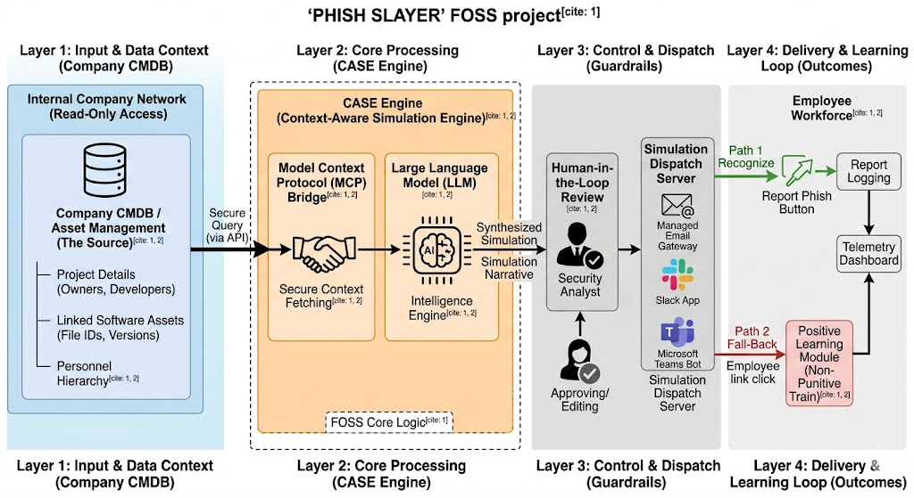

# Phish4Good — Concept & design

Phish4Good is an open-source **Threat-to-Training** platform: convert trusted cyber advisories and real-world events into safe, role-relevant security exercises — grounded, validated, and human-approved.

**Goal:** help defenders train at the speed of attackers. **Not** to create better phishing.

**Related:** [Hackathon proposal](../Phish4Good_HackathonProposal.md) · [PoC demo](./PHISH4GOOD_POC.md) · [README](../README.md) · [Hypotheses](./HYPOTHESES.md) · [Threat model](./THREAT_MODEL.md) · [Responsible use](./RESPONSIBLE_USE.md)

---

## Problem

Security-awareness programs run on a calendar. Attacker campaigns run on the news cycle.

- After major outages or CVE disclosures, phishing lures appear within hours (e.g. Microsoft 365 “held messages” / `EX1550543` campaigns in Nov 2026).  
- Generic annual modules cannot reference yesterday’s event or the pretext each cohort actually faces.  
- Hand-built simulations take days, so they miss the attacker’s window.  
- Employees are rarely taught the habit that matters: **verify unexpected requests through official channels**, not the link in the message.  
- Naïve “generate phishing from the news” automation is dangerous: hallucination, privacy leaks, unsafe realism.

## Solution: Threat-to-Training pipeline

Each event passes through the same seven stages (proposal §3.1):

| Step | Stage | What happens |
|------|--------|----------------|
| 1 | Ingest | Trusted advisories / bulletins / status reports, stored with source link |
| 2 | Identify cohorts | Role-level mapping (platform, helpdesk, finance, all staff, …). **No individual profiling** |
| 3 | Generate | Simulation grounded in advisory facts; citations + red flags |
| 4 | Validate | Privacy, safety, grounding; no live malicious links or credential capture |
| 5 | Human approval | Reviewer approves, edits, or rejects |
| 6 | Deliver | Sandboxed internal channel; clicks recorded; no credentials |
| 7 | Debrief | How the pretext worked + how to verify officially |

### Optional Mode B — CASE (context-aware personalization)

**Context-Aware Simulation Engine (CASE):** allowlisted professional CMDB metadata → LLM/mock draft → policy → human stage. Useful for technical spear-phish *style* drills; secondary to event→cohort training in this PoC.

---

## Layer status (PoC vs idea)

| Layer | Intent | Status in this repo |
|-------|--------|---------------------|
| Advisory ingest + source allow-list | Ground exercises in trusted events | **Implemented (PoC)** — JSON seeds + manual ingest; no live scrapers |
| Cohort mapper | Product/tech → role cohorts | **Implemented (PoC)** — rule-based MVP |
| Grounded generator (citations, red flags) | Event + cohort → exercise | **Implemented (PoC)** — Gemini + mock templates |
| Policy + grounding validator | Block unsafe / ungrounded drafts | **Implemented (PoC)** — hard gate on approve |
| Approval queue / dashboard | Human control + edit | **Implemented (PoC)** — in-memory queue |
| Sandbox delivery | Safe channel; no real send | **Implemented (PoC)** — synthetic inbox |
| Debrief (“how this pretext worked”) | Verification habit | **Implemented (PoC)** — event-aware debrief panel |
| Aggregate cohort metrics | Behavior signals without individual scorecards | **Implemented (PoC)** — `/api/metrics` |
| Synthetic CMDB + CASE (Mode B) | Personalized technical lures | **Implemented (PoC)** |
| Field allowlist + prompt hygiene (Mode B) | Minimize prompt data | **Implemented (PoC)** |
| Real dispatch (email / Slack / Teams) | Production delivery | **Idea only** — out of scope |
| PostgreSQL / durable audit ledger | Persistence & compliance | **Idea only** — PoC is in-memory |
| Auth, RBAC, multi-tenant | Enterprise controls | **Idea only** |
| Live advisory collectors | Scheduled feed pull | **Idea only** — seeds + allow-listed ingest |

### PoC flow (what runs today)

**Mode A — Threat-to-Training (primary)**

```text
seeded advisory → cohort mapper → Gemini/mock exercise → policy+grounding validate → human approve → sandbox inbox → debrief (+ aggregate metrics)
```

**Mode B — Personalized CASE (optional)**

```text
synthetic CMDB → mock MCP context → LLM (or mock) → policy check → human review → in-memory telemetry
```

Demo script: [PHISH4GOOD_POC.md](./PHISH4GOOD_POC.md).

### Vision architecture (aspirational)



*Caption: longer-term layered design (real connectors, dispatch, learning loop). Most boxes remain **Idea only**. The running hackathon PoC is the Mode A pipeline above on Preact + Fastify + in-memory/JSON.*

---

## Safety and responsible-use guardrails

From the proposal — the platform stays on the defender’s side:

- **Grounded, not invented** — factual claims must cite the advisory; unsupported claims fail validation  
- **Safe by construction** — controlled sandbox domains/paths; no credential capture; no malware; no external sending  
- **Privacy-preserving** — cohort-level targeting; no personal data in Mode A prompts; aggregate reporting  
- **Human in the loop** — approve / edit / reject logged for the session  
- **Defender-focused output** — red flags + verification steps; not reusable attack kits  
- **Open and reviewable** — code, policy rules, and templates are FOSS  

## Technology (honest)

**Implemented in this PoC**

- Node.js, Fastify backend  
- Preact + Vite + Tailwind frontend (proposal mentioned React; PoC kept Preact for speed)  
- Google Gemini (`gemini-3.5-flash-lite` by default) with offline mock fallback  
- pnpm workspace monorepo; in-memory / JSON seeds (not PostgreSQL yet)  

**Possible later:** live collectors, durable DB, real MCP/CMDB connectors, other LLM providers / local models, dispatch adapters, auth/RBAC.

## Data handling (honest)

Mode A prompts receive **advisory text + cohort description only**. Mode B sends only **allowlisted** professional CMDB fields through a single prompt-building boundary. Cloud LLM **provider terms** still apply when a key is used. Prefer local/self-hosted models for sensitive environments.

## Expected outcomes (aspirational — not measured here)

| Outcome | Description |
|---------|-------------|
| Faster time-to-training | Advisory → approved exercise in hours while the pretext is live |
| Role-relevant exercises | Cohorts see the lure they are most likely to face |
| Verification habit | Official-channel checks instead of message links |
| Safe governed automation | Grounding + policy + human approval |
| Measurable behavior change | Aggregate click / report / verify rates by cohort |
| Community benefit | Open pipeline, policies, and templates |

See [HYPOTHESES.md](./HYPOTHESES.md) for how to test these without over-claiming.

## If this were taken further

1. Scheduled collectors for allow-listed advisory / status feeds with durable dedupe  
2. PostgreSQL (or equivalent) for events, approvals, and aggregate outcomes  
3. Auth, roles, immutable audit log, and rate limits  
4. Optional plug-in to an existing simulation dispatch platform  
5. Stronger evaluation harness (grounding, policy, human ratings)  
6. Local-model path for sensitive data  
7. Privacy / labor-law review before any per-person adaptive difficulty  

**Note on adaptive difficulty:** scoring *individuals* and escalating pressure raises privacy and labor-law concerns. Prefer cohort-level or voluntary skill tracks.

## FAQ (aligned with the code)

### Is it production-ready?
No. Local hackathon PoC on synthetic data.

### What is the primary demo?
Threat-to-Training: pick a seeded event (start with M365 outage) → map cohorts → generate → approve → sandbox click → debrief.

### What data goes to the LLM?
**Mode A:** advisory + cohort only. **Mode B:** allowlisted professional CMDB fields only (see UI “fields sent to the model”).

### How is consent enforced?
It is **not** enforced in the PoC. Authorization and auditability are requirements for any real deployment.

### Does a human review before delivery?
Yes. Approve is required; validation must pass. Delivery is sandbox-only — there is no real send path.

### Which systems does it integrate with?
None in production. Seeds + synthetic CMDB. Real ServiceNow/Jira/email connectors are ideas only.

## Licensing

**GPL-3.0**. The maintainer may revisit licensing for connectors or dual-licensing later; nothing here changes the current LICENSE file.
