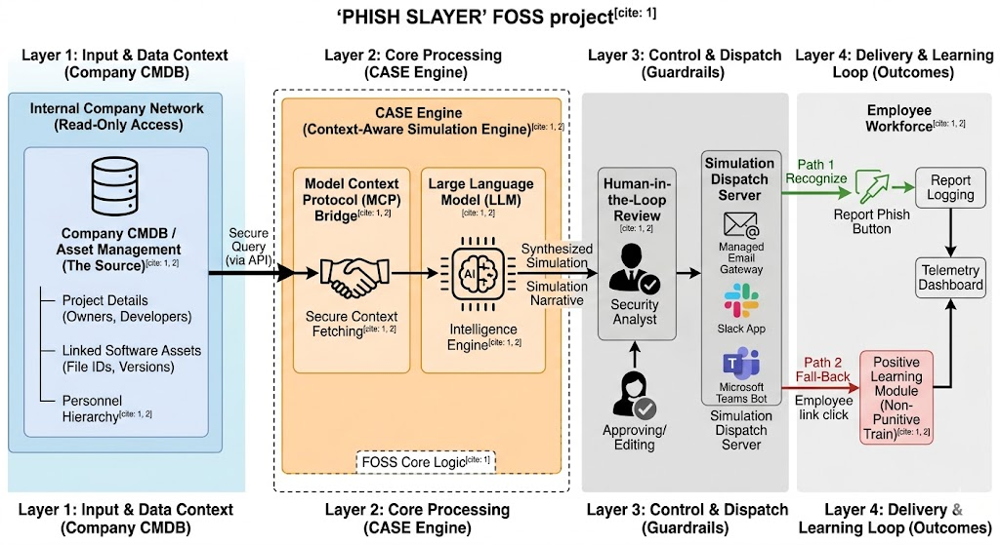

# PHISH SLAYER — Concept & design exploration

This document captures the **idea** behind PHISH SLAYER: a context-grounded phishing-simulation research direction. It is **not** a product proposal, delivery plan, or claim of production readiness.

**Related:** [README](../README.md) · [MCP notes](../MCP_ARCHITECTURE.md) · [Examples](../EXAMPLES.md) · [Hypotheses](./HYPOTHESES.md) · [Threat model](./THREAT_MODEL.md) · [Responsible use](./RESPONSIBLE_USE.md)

---

## Problem

Security awareness often relies on static templates (“Password expired,” “HR policy update”). People learn those patterns and stop transferring the skill to novel attacks. Real spear-phishing uses OSINT and internal context — projects, tools, colleagues. Security teams rarely have bandwidth to hand-craft that depth for every audience.

## Limits of existing systems (as commonly observed)

- Template libraries that are not tied to the learner’s actual work context  
- Little or no native use of asset / CMDB / identity metadata  
- Failure-focused UX without a concrete, scenario-specific debrief  

These are design observations, not a competitive benchmark study.

## The CASE idea

**Context-Aware Simulation Engine (CASE):** pull allowlisted professional metadata (e.g. project IDs, linked tools, peer roles), ask an LLM to draft a simulation narrative grounded in that metadata, and require a human analyst to approve or edit before anything is staged. The PoC never dispatches messages.

## Layer status (PoC vs idea)

| Layer | Intent | Status in this repo |
|-------|--------|---------------------|
| Synthetic / real CMDB context | Source of grounding anchors | **Implemented (PoC)** — in-memory synthetic CMDB only |
| MCP-style context bridge | Standardize tool-style reads | **Mock** — HTTP route shaped like context fetch; not a real MCP server |
| LLM generation | Draft subject / pretext / body | **Implemented (PoC)** — Gemini with mock fallback |
| Field allowlist + prompt hygiene | Minimize and delimit untrusted data | **Implemented (PoC)** — `fieldAllowlist.js`, `promptSanitize.js`, `buildPromptPayload.js` |
| Content policy gate | Block sensitive personal/HR topics | **Implemented (PoC)** — `contentPolicy.js` + UI block on approve |
| Human-in-the-loop review UI | Approve / edit / discard | **Implemented (PoC)** |
| Dispatch (email / Slack / Teams) | Deliver simulations | **Idea only** — out of scope |
| Persistent telemetry / reporting | Measure campaigns | **Mock** — in-memory array only |
| Positive / specific debrief UX | Teach the red flag in *this* message | **Partial** — click opens a simple “Glory Kill” modal; not a full learning product |
| Auth, RBAC, audit ledger, multi-tenant | Enterprise controls | **Idea only** |

### PoC flow (what runs today)

```text
synthetic CMDB → mock MCP context → LLM (or mock) → policy check → human review → in-memory telemetry
```

### Vision architecture (not built)



*Caption: aspirational layered design (real CMDB connectors, dispatch, learning loop). Most boxes are **Idea only**. The running PoC is the short flow above: synthetic CMDB → mock MCP → LLM → policy → human review → in-memory telemetry.*

## Technology (honest)

**Implemented in this PoC**

- Node.js, Fastify backend  
- Preact + Vite + Tailwind frontend  
- Google Gemini (`gemini-2.5-flash` by default) with offline mock fallback  
- pnpm workspace monorepo  

**Possible later (not implemented):** other LLM providers (Claude, Llama, OpenAI, local models), real MCP servers, CMDB connectors (ServiceNow, Jira SM, etc.), dispatch adapters. Python and alternate UI frameworks are not used here.

## Data handling (honest)

What reaches the model depends on the **LLM provider’s terms** (retention, training use, residency). This PoC reduces risk by sending only **allowlisted** professional fields through a single prompt-building boundary, with sanitization of untrusted CMDB strings. For sensitive environments, a **local / self-hosted model** is the safer option. The repo does **not** claim that PII or IP “never enters training memory.”

## Dispatch and commercial platforms

Dispatch, deliverability, tracking pixels, and enterprise reporting integrations are **out of scope**. This idea could **plug into** existing phishing platforms rather than replace them. It is not a drop-in replacement for commercial SAT products.

## Debrief / “Glory Kill” today vs idea

**Today:** simulating a link click opens a modal that frames the event as a learning moment and shows staged metadata. There is no adaptive curriculum, skill-gap mapping, or LMS integration.

**Idea:** a short, non-punitive debrief that points at the *verifiable* red flag in that specific message (mismatched sender vs named project owner, odd URL vs known tool, etc.).

## Advantages worth testing (not proven)

- Personalization at analyst-assisted scale  
- Training that tests verification habits, not template recognition  
- FOSS exploration without vendor lock-in for the *generation* layer  

None of these are measured results in this repository. See [HYPOTHESES.md](./HYPOTHESES.md).

## Hypotheses to test (not KPI targets)

| Question | Why it might be wrong | How to probe |
|----------|----------------------|--------------|
| Grounded lures change report/click rates vs good generic lures | Novelty fades; generics may already be strong | A/B with matched difficulty, authorized pilot |
| Specific debriefs beat generic training pages | Attention/fatigue dominate content quality | Randomize debrief style; measure short-term recall |
| Grounding checks catch hallucinations | Models paraphrase IDs; checkers miss variants | Automate string presence vs CMDB; human spot-check |
| CMDB is the best context source | Calendars/tickets may be richer | Compare context sources for lure plausibility ratings |
| Personalization stays ethical under policy gates | Pressure tactics still harm trust | Red-team policy rules; works-council review |

There are **no** claimed CTR/TTR percentage targets, deployment counts, or “100% compliance” goals in this concept.

## If this were taken further

1. Real read-only CMDB connectors behind a true MCP (or plain) API  
2. Optional plug-in to an existing simulation dispatch platform  
3. Stronger evaluation harness (grounding, policy, human ratings)  
4. Auth, roles, immutable audit log, and rate limits  
5. Local-model path for sensitive data  
6. Privacy / labor-law review before any per-person adaptive difficulty  

**Note on adaptive difficulty:** scoring *individuals* and escalating pressure raises privacy and labor-law concerns. Prefer department-level or voluntary skill tracks if explored at all.

## FAQ (aligned with the code)

### Is it production-ready?
No. It is a local proof of concept.

### What data goes to the LLM?
Only fields on the prompt allowlist (professional identifiers such as role, department, project IDs, linked tool refs, asset display names, peer roles). Contact details and other disallowed fields are dropped at the prompt-building boundary. See the allowlist module and the “fields sent to the model” panel in the UI.

### How is consent enforced?
It is **not** enforced in the PoC. Consent, authorization, and auditability are design requirements for any real deployment — not implemented here.

### Does a human review before “send”?
Yes for staging: the dashboard requires generate → edit/approve → in-memory telemetry. There is no real send path.

### Which systems does it integrate with?
None in production. The PoC uses a synthetic CMDB. Real ServiceNow/Jira/Slack/Teams connectors are ideas only.

## Licensing

This project is licensed under **GPL-3.0**. The maintainer may revisit licensing for connectors or dual-licensing later; nothing here changes the current LICENSE file.
